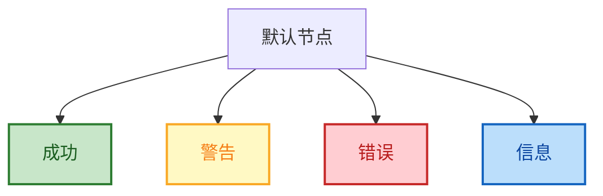
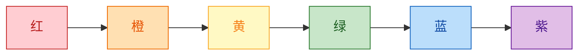
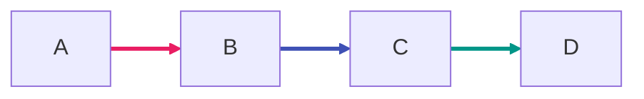
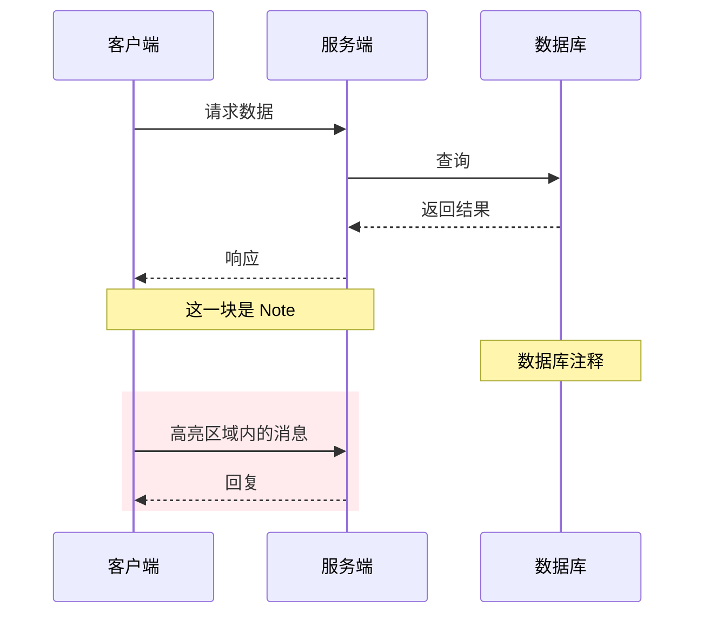
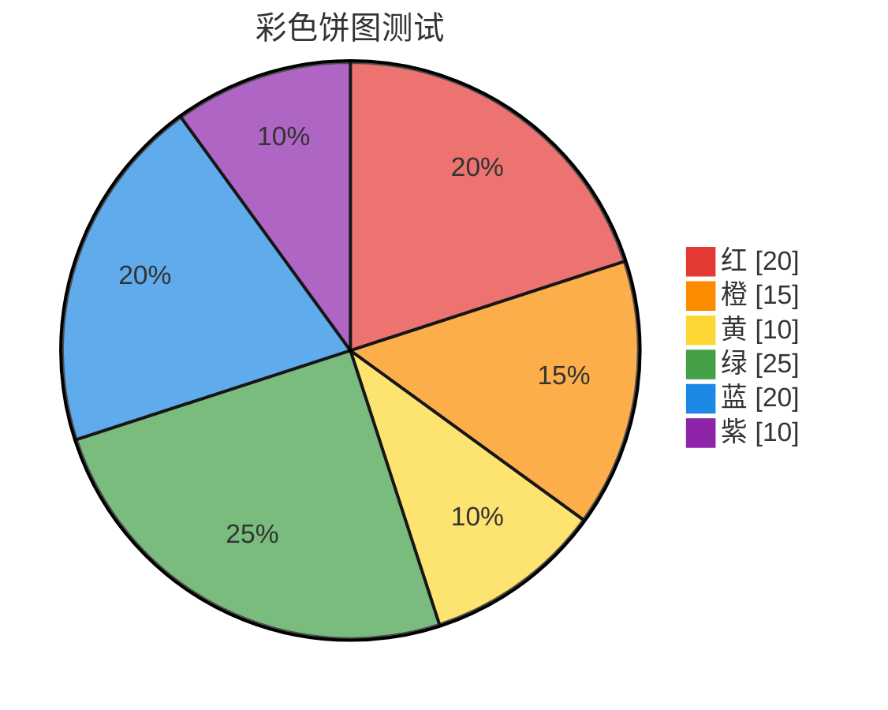
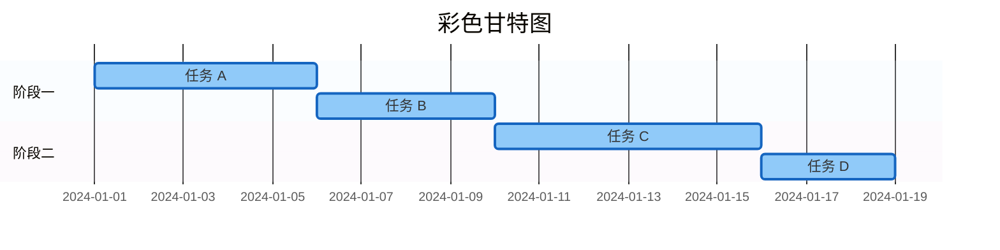
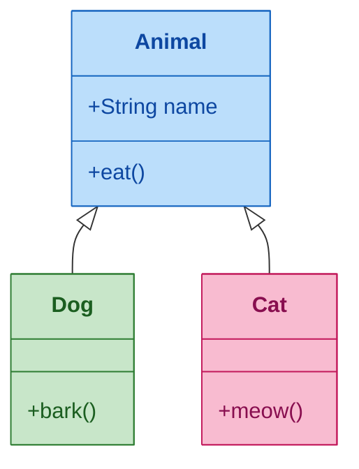
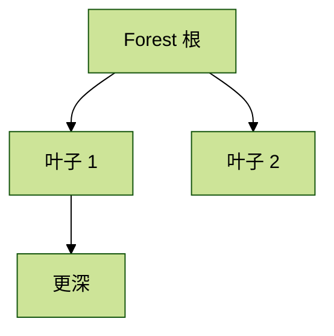
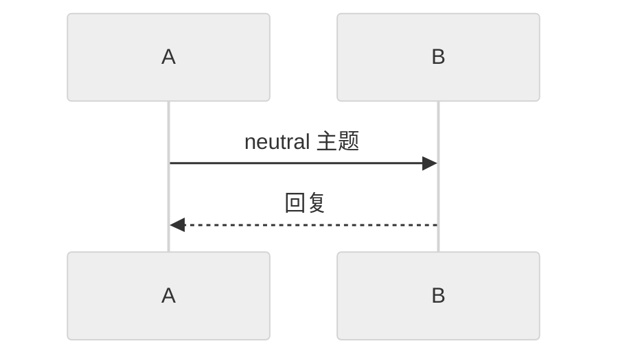

# Mermaid 彩色测试

## 主题变量（themeVariables）— 流程图


## classDef 着色 — 流程图



## style 内联着色 — 流程图



## linkStyle 着色 — 连线颜色



## 彩色时序图



## 彩色状态图

```mermaid
stateDiagram-v2
    [*] --> 空闲
    空闲 --> 加载中: 开始
    加载中 --> 成功: 完成
    加载中 --> 失败: 出错
    成功 --> [*]
    失败 --> 空闲: 重试

    classDef idle fill:#e3f2fd,stroke:#1565c0
    classDef loading fill:#fff9c4,stroke:#f9a825
    classDef ok fill:#c8e6c9,stroke:#2e7d32
    classDef err fill:#ffcdd2,stroke:#c62828

    class 空闲 idle
    class 加载中 loading
    class 成功 ok
    class 失败 err
```

## 彩色饼图



## 彩色甘特图



## 彩色类图



## 深色主题（dark）


## 森林主题（forest）



## 中性主题（neutral）

