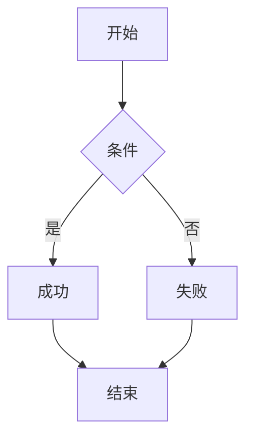
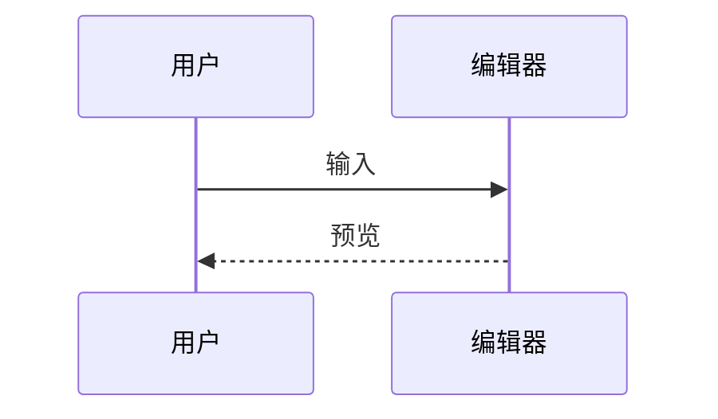
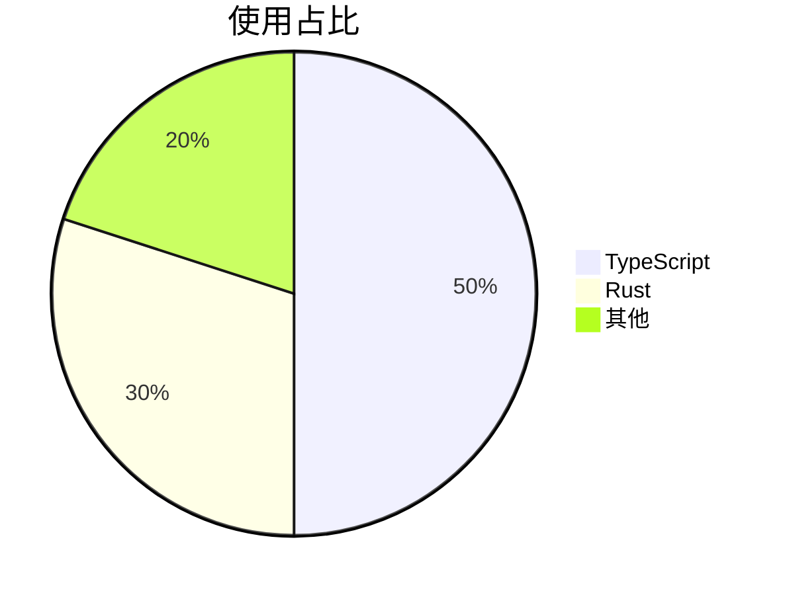

# 综合压力测试

这是综合了各类语法的长文档，用于测试编辑器在处理混合内容时的解析、高亮、实时预览和滚动性能。

---

## 1. 标题层级

# H1
## H2
### H3
#### H4
##### H5
###### H6

---

## 2. 段落与文本格式

这是第一段。**粗体**、*斜体*、***粗斜体***、~~删除线~~、`行内代码`、<mark>高亮</mark>、<kbd>Ctrl</kbd> + <kbd>S</kbd>。

这是第二段，包含中英文混排：The quick brown fox jumps over the lazy dog，以及更多中文内容用于测试换行和排版。

> 引用块：**加粗引用**，`代码引用`，[链接引用](https://example.com)。

---

## 3. 列表

- 无序第一项
- 无序第二项
  - 嵌套 A
  - 嵌套 B
    - 更深一层
- 无序第三项

1. 有序第一步
2. 有序第二步
   1. 子步骤 A
   2. 子步骤 B
3. 有序第三步

- [x] 已完成任务
- [ ] 未完成任务
- [x] 另一个已完成任务

---

## 4. 链接与图片

[Google](https://google.com)、[百度](www.baidu.com)、<https://github.com>、<test@example.com>。


---

## 5. 代码块

```swift
import Foundation

struct Point {
    var x: Double
    var y: Double

    func distance(to other: Point) -> Double {
        let dx = x - other.x
        let dy = y - other.y
        return (dx * dx + dy * dy).squareRoot()
    }
}
```

```javascript
const fib = n => (n < 2 ? n : fib(n - 1) + fib(n - 2));
console.log([0, 1, 2, 3, 4, 5].map(fib));
```

```python
def quicksort(arr):
    if len(arr) <= 1:
        return arr
    pivot = arr[len(arr) // 2]
    left = [x for x in arr if x < pivot]
    mid = [x for x in arr if x == pivot]
    right = [x for x in arr if x > pivot]
    return quicksort(left) + mid + quicksort(right)
```

```rust
fn main() {
    let v: Vec<i32> = (1..=10).collect();
    let sum: i32 = v.iter().sum();
    println!("sum = {}", sum);
}
```

```sh
#!/usr/bin/env bash
set -euo pipefail
for f in *.md; do
  echo "Processing $f"
  wc -l "$f"
done
```

---

## 6. 表格

| 语言       | 类型       | 出现年份 |
| ---------- | ---------- | -------- |
| Swift      | 编译型     | 2014     |
| JavaScript | 解释型     | 1995     |
| Python     | 解释型     | 1991     |
| Rust       | 编译型     | 2010     |

| 左对齐 | 居中 | 右对齐 |
| :----- | :--: | -----: |
| a      |  b   |      c |
| 长一点 |  中  |   1234 |

---

## 7. HTML 扩展

<details>
<summary>点击展开</summary>

折叠内容支持 **Markdown**：

- 列表项 1
- 列表项 2

</details>

<div style="padding: 8px; border: 1px solid #ccc;">
  这是一个 div 容器。
</div>

<svg width="60" height="60" viewBox="0 0 60 60" xmlns="http://www.w3.org/2000/svg">
  <circle cx="30" cy="30" r="25" fill="#bbdefb" stroke="#1565c0" stroke-width="3" />
</svg>

---

## 8. Mermaid







---

## 9. 数学公式

行内：$E = mc^2$，$\sum_{i=1}^{n} i = \frac{n(n+1)}{2}$。

块级：

$$
\begin{aligned}
f(x) &= ax^2 + bx + c \\
f'(x) &= 2ax + b
\end{aligned}
$$

矩阵：

$$
\begin{bmatrix}
1 & 2 \\
3 & 4
\end{bmatrix}
$$

---

## 10. 长内容（压力测试用）

### 段落重复 1

这是用于压力测试的重复段落。它包含中英文混排、**粗体**、*斜体*、`代码`、[链接](https://example.com) 等元素。The quick brown fox jumps over the lazy dog. 这段话会重复多次，用于测试大文档下的编辑性能和预览更新性能。

这是用于压力测试的重复段落。它包含中英文混排、**粗体**、*斜体*、`代码`、[链接](https://example.com) 等元素。The quick brown fox jumps over the lazy dog. 这段话会重复多次，用于测试大文档下的编辑性能和预览更新性能。

这是用于压力测试的重复段落。它包含中英文混排、**粗体**、*斜体*、`代码`、[链接](https://example.com) 等元素。The quick brown fox jumps over the lazy dog. 这段话会重复多次，用于测试大文档下的编辑性能和预览更新性能。

### 段落重复 2

这是用于压力测试的重复段落。它包含中英文混排、**粗体**、*斜体*、`代码`、[链接](https://example.com) 等元素。The quick brown fox jumps over the lazy dog. 这段话会重复多次，用于测试大文档下的编辑性能和预览更新性能。

这是用于压力测试的重复段落。它包含中英文混排、**粗体**、*斜体*、`代码`、[链接](https://example.com) 等元素。The quick brown fox jumps over the lazy dog. 这段话会重复多次，用于测试大文档下的编辑性能和预览更新性能。

这是用于压力测试的重复段落。它包含中英文混排、**粗体**、*斜体*、`代码`、[链接](https://example.com) 等元素。The quick brown fox jumps over the lazy dog. 这段话会重复多次，用于测试大文档下的编辑性能和预览更新性能。

### 段落重复 3

这是用于压力测试的重复段落。它包含中英文混排、**粗体**、*斜体*、`代码`、[链接](https://example.com) 等元素。The quick brown fox jumps over the lazy dog. 这段话会重复多次，用于测试大文档下的编辑性能和预览更新性能。

这是用于压力测试的重复段落。它包含中英文混排、**粗体**、*斜体*、`代码`、[链接](https://example.com) 等元素。The quick brown fox jumps over the lazy dog. 这段话会重复多次，用于测试大文档下的编辑性能和预览更新性能。

这是用于压力测试的重复段落。它包含中英文混排、**粗体**、*斜体*、`代码`、[链接](https://example.com) 等元素。The quick brown fox jumps over the lazy dog. 这段话会重复多次，用于测试大文档下的编辑性能和预览更新性能。

### 段落重复 4

这是用于压力测试的重复段落。它包含中英文混排、**粗体**、*斜体*、`代码`、[链接](https://example.com) 等元素。The quick brown fox jumps over the lazy dog. 这段话会重复多次，用于测试大文档下的编辑性能和预览更新性能。

这是用于压力测试的重复段落。它包含中英文混排、**粗体**、*斜体*、`代码`、[链接](https://example.com) 等元素。The quick brown fox jumps over the lazy dog. 这段话会重复多次，用于测试大文档下的编辑性能和预览更新性能。

这是用于压力测试的重复段落。它包含中英文混排、**粗体**、*斜体*、`代码`、[链接](https://example.com) 等元素。The quick brown fox jumps over the lazy dog. 这段话会重复多次，用于测试大文档下的编辑性能和预览更新性能。

### 段落重复 5

这是用于压力测试的重复段落。它包含中英文混排、**粗体**、*斜体*、`代码`、[链接](https://example.com) 等元素。The quick brown fox jumps over the lazy dog. 这段话会重复多次，用于测试大文档下的编辑性能和预览更新性能。

这是用于压力测试的重复段落。它包含中英文混排、**粗体**、*斜体*、`代码`、[链接](https://example.com) 等元素。The quick brown fox jumps over the lazy dog. 这段话会重复多次，用于测试大文档下的编辑性能和预览更新性能。

这是用于压力测试的重复段落。它包含中英文混排、**粗体**、*斜体*、`代码`、[链接](https://example.com) 等元素。The quick brown fox jumps over the lazy dog. 这段话会重复多次，用于测试大文档下的编辑性能和预览更新性能。

---

## 11. 代码块重复（压力测试）

```javascript
function task1() { return 1; }
function task2() { return 2; }
function task3() { return 3; }
function task4() { return 4; }
function task5() { return 5; }
function task6() { return 6; }
function task7() { return 7; }
function task8() { return 8; }
function task9() { return 9; }
function task10() { return 10; }
```

```python
def task1(): return 1
def task2(): return 2
def task3(): return 3
def task4(): return 4
def task5(): return 5
def task6(): return 6
def task7(): return 7
def task8(): return 8
def task9(): return 9
def task10(): return 10
```

```rust
fn task1() -> i32 { 1 }
fn task2() -> i32 { 2 }
fn task3() -> i32 { 3 }
fn task4() -> i32 { 4 }
fn task5() -> i32 { 5 }
fn task6() -> i32 { 6 }
fn task7() -> i32 { 7 }
fn task8() -> i32 { 8 }
fn task9() -> i32 { 9 }
fn task10() -> i32 { 10 }
```

---

## 12. 结尾

本文档用于综合压力测试，覆盖标题、段落、格式、列表、链接、图片、代码块、表格、HTML、Mermaid、数学公式、长内容重复等场景。